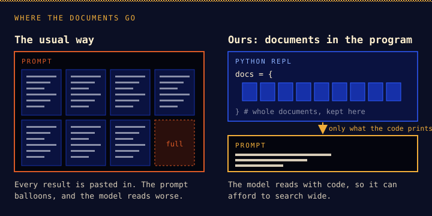

Deep-search agents answer hard questions by searching many times and reasoning over what they find. The usual way to build one is to paste every search result into the prompt. That leaves you choosing between short snippets, which hide the evidence, and whole documents, which make the prompt balloon, and models get worse at reading as prompts grow.

So we tried keeping the documents in the program instead. Every search drops whole documents into a variable in a Python REPL, the model reads them by writing code, and only what that code prints ends up in its context. Because a document costs nothing until it’s printed, the agent can afford to search wide, and a cap on the number of searches, rather than the context window, decides how much it fetches.

I wrote this in my spare time, together with colleagues from neuland.ai, TU Munich, TH Köln and the Data Science Group at Paderborn University.

## How it works

Each search returns the full text of the top *k* documents (the model picks *k*, up to 50) and adds them to a dictionary that sticks around between turns, printing just one short line. The model then reads with Python, for example by slicing a document or grepping across everything it holds. The sandbox is closed off: no network modules, no file access, no `eval` or `exec`, and the process can only reach the model and the local retriever.

The prompt stays small as a result. Across all 830 questions the median prompt was 21k tokens, while the documents the agent held had a median of 638k tokens, more than twice what the model could take as input.

## Results

| Comparison (GPT-5, dense retrieval) | Accuracy | Tokens per question |
|---|---|---|
| Ours, 680 held-out questions (cap 20) | **86.6%** | 197k |
| Function-calling agent + document tool | 77.5% | not reported |
| Fetch-then-Explore | 78.4% | 772k |
| Ours, 150 development questions (cap 10) | **83.3%** | 185k |
| Benchmark reference agent | 69.3% | 895k |

The ablations tell a simple story: searching wide is what finds the evidence, and keeping documents out of the prompt is what makes searching wide affordable. Cut the agent back to five documents per search and it drops to the reference agent’s level. It also leads on FRAMES (80.7% against 76.3%) and runs end to end with the open-weight Qwen3.6-35B-A3B.

## On the leaderboard

I also led neuland.ai’s entry on the public [BrowseComp-Plus leaderboard](https://huggingface.co/spaces/Tevatron/BrowseComp-Plus), built on a patched recursive-language-model REPL where the agent decides how wide each search goes. With GPT-5 and the Reason-ModernColBERT retriever it reached 87.1% with the **lowest calibration error on the leaderboard** (2.26%, of the 76 entries that report it) and the **fewest searches of any entry above 85% accuracy** (8.1 per question), as of November 2026.

LightOn’s entry makes a clean controlled comparison, because it uses the same model and the same retriever. It scores 87.6%, but needs 13.3 searches per question and has a calibration error of 6.1%. With model and retriever held fixed, our agent reaches the same accuracy with **39% fewer searches** and **2.7× lower calibration error**.

## Smaller models

I’ve also trained small language models with supervised fine-tuning and reinforcement learning to make them better at agentic search, so this kind of behaviour doesn’t need a frontier model behind it.

## If you build agents

Keep retrieved documents out of the prompt and print one line per search. Let the model read them with code, or with read and grep tools if you can’t sandbox its code. Let it search wide, and cap the number of searches instead of leaning on the context window. Tune that cap on one set of questions and check it on another. And if something has to leave the prompt for good, summarise it rather than delete it.
