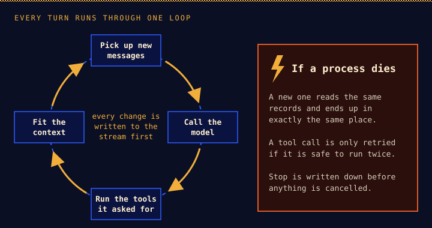
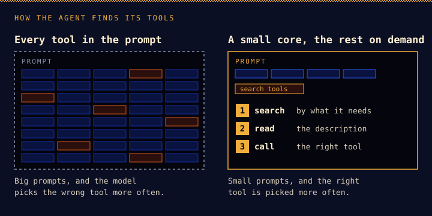
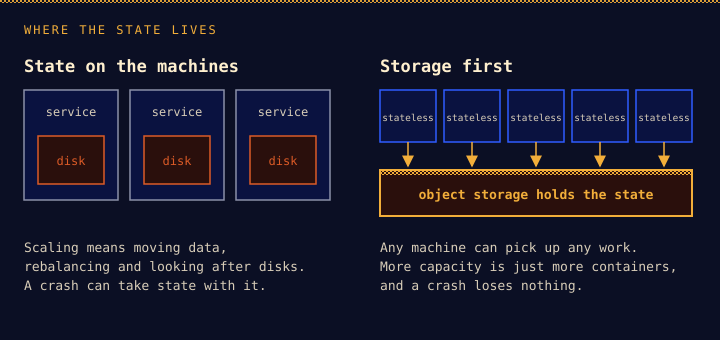

This is where most of my time goes. neuland.ai’s agent platform is a shared workspace: people talk to an agent that has tools, a sandbox, files and its own sub-agents, and several people can work with the same agent at once. I designed its system architecture, and I build it with a small team, on the server and in the web client. It runs in production for a lot of users.

Here’s the short version before the tour:

```stats
SoTA | on Terminal-Bench 2.0 and 2.1 in our internal runs, ahead of Codex and Claude Code
3× | fewer tokens than Codex
#1 | lowest calibration error of 76 entries on BrowseComp-Plus
```

## The whole thing on one page


1. You send a message, and it lands on your workspace’s durable stream.
2. A supervisor picks it up and drives the turn.
3. The turn calls the model and runs tools. Every tool call passes a permission check, and code runs in a sandbox.
4. Every step is written to the stream before it happens.
5. Your screen and the database are rebuilt from that same stream, live.

The one idea that holds it all together: **the stream is the truth**. Nothing important lives only inside a running process, so if a process dies, another one picks the workspace up exactly where it was.

## How it measures up

I built the agent harness behind these results. In our internal runs it reaches state-of-the-art results on Terminal-Bench 2.0 and 2.1, ahead of Codex and Claude Code, while using about three times fewer tokens than Codex. On Databricks’ OfficeQA Pro V2, where agents reason across two centuries of U.S. federal financial records, it beats Databricks Genie.

I also led our entry on the public [BrowseComp-Plus leaderboard](https://huggingface.co/spaces/Tevatron/BrowseComp-Plus). For a search agent you want to trust, two things matter a lot: how well its confidence matches how often it’s actually right (calibration error), and how many searches it needs. This chart shows every entry above 85% accuracy:


Ours sits alone in the bottom-left corner: the lowest calibration error of all 76 scored entries, and the fewest searches of any entry above 85%. The fairest comparison is LightOn’s entry, because it uses the same model and the same retriever, so the agent is the only thing that differs:

```stats
39% | fewer searches at the same accuracy
2.7× | lower calibration error
```

## One loop for every turn



Every turn picks up new messages between steps, keeps the conversation within the model’s context, calls the model and runs whatever tools it asks for. The important part is the middle of the circle: every change is written down first. If a process dies halfway through, a new one reads the same records and ends up in exactly the same place.

A few things fall out of that:

- **Tools describe themselves.** Each tool says what it needs, whether it’s safe to repeat and whether it can run alongside others. The runtime takes it from there: what to offer the model, what to ask a person about, and what to rerun after a crash.
- **Sub-agents can’t get lost.** Each one has its own transcript and sandbox and runs under a lease, so if one disappears it’s rebuilt or wrapped up instead of being started twice.
- **Long chats stay cheap.** Conversations are summarised in the background before they hit the limit, and the prompt is rebuilt from the log, so it comes out the same after a restart and prompt caching keeps working.
- **Stop always means stop.** People can nudge a running turn, and Stop is written down before anything is cancelled, so even a crash in the middle of stopping still ends as a stop.

## Finding the right tool



Once people start adding plugins and custom tools, you can’t put every tool in the prompt anymore. So I built tool discovery: the model always sees a small core set, and finds everything else when it needs it by searching, reading a tool’s description and then calling it. Prompts stay much smaller, and the agent picks the right tool more often than when everything is crammed in.

## Fitting a lot of people onto very little hardware

All of this runs on a handful of ordinary 8- and 16-core VMs. Workspaces live in slots on pooled hosts, placed by a consistent hash per organisation, so adding a host doesn’t reshuffle everyone. The process driving a turn holds a lease with an epoch, and the stream refuses writes from an older one, so two machines can never run the same step.

A big part of my work was load testing to fit as many people as possible onto those machines. Instead of guessing, we measured what a hosted workspace really costs in memory, what an active turn costs in CPU, and where live updates start to slow down. The measurements changed the design:

```stats
12× | less memory set aside per host, once sized from real usage
15× | less slot time per turn: a turn hands its slot back while the model thinks
29× | CPU overcommit hiding in the scheduler, caught and fixed
```

Every one of those measured limits is now a check in CI, so no config change can quietly go past what the hardware can carry. We also wrote the turn, plan and approval states down as explicit state machines shared with the web client, so every screen gives the same answer to “is this running, can I stop it, does it need me?”

## Durable streams

Each workspace has its own durable stream, an append-only log that everything is rebuilt from: chat, turn state, plans, approvals and spend.

- **Retries are written once.** Every write carries a producer id and a sequence number, so a retried message lands once, even on another replica, and the Postgres read model applies each record exactly once.
- **Rollouts don’t break readers.** Writers are strict and readers are forgiving, so old and new versions can read each other’s streams mid-rollout.
- **Clients pick up where they left off.** Checkpoints keep reads short, and the web client follows the same stream live with a signed cursor.

The biggest piece here was moving every stored stream to a new format. We made readers tolerant first, then wrote a migration tool that refused any translation that would change what the model or a person sees. A second stream server ran side by side behind a switch we could flip back, production moved over, and once everything had settled we deleted the migration tool.

## Storage first, compute second



These days I design around object storage rather than compute. Durable state goes into buckets, and the services that work on it stay stateless. Scaling a bucket is the cloud provider’s problem, and cheap. Scaling stateful compute means moving data around, rebalancing and looking after disks.

The industry calls this separating storage and compute, and its newer, stricter form is zero-disk or diskless architecture. [WarpStream](https://www.warpstream.com/blog/kafka-is-dead-long-live-kafka) runs Kafka-compatible streaming on stateless agents over S3, and [ClickHouse Cloud](https://clickhouse.com/blog/clickhouse-cloud-stateless-compute) made its compute fully stateless in 2025. It suits agents especially well, because an agent’s state is already a log you can rebuild from.

## Letting agents act for people, safely


An agent should never be able to do more than the person it’s working for. So every tool call is checked twice: is there a grant that covers it, and does that person still have the right to do it themselves? Agents never hold credentials; the product asks the identity service on each call.

In shared workspaces, each person lends the agent their own tools and data, every grant remembers who gave it, and each call stays within that person’s rights. When someone leaves, their agents, grants and tokens go with them. I moved the platform to this model in a long series of small, carefully tested steps that ended in a migration we could reverse.

## Sandboxes and models

**Sandboxes.** Each agent and sub-agent gets its own microVM with the workspace’s files mounted. It boots the first time it’s needed and recovers on its own after a failed boot. Network access goes through a gate per sandbox: code can only reach hosts a person approved, approvals don’t last long, and things get stricter once the code has touched private data.

**Models.** All model calls go through one streaming interface across several providers and three clouds. Partial output survives a broken stream, throttling is retried with backoff (even the kind hidden inside a successful response), and a deadline on the first response catches requests that hang. Every call’s usage is charged to the right payer and recorded once, including calls that failed or were cancelled.

## Seeing what agents do

When an agent misbehaves, you need to see what it actually did. I set up tracing, metrics and observability on SigNoz, including spans for everything in a turn that isn’t model time: tool calls, building the context, waiting for a sandbox, waiting for someone to approve. Raw traces are great for engineers but hard for anyone else to read, so I also built our own trace view in the app: one row per shell command the agent ran, with its network requests right underneath.

## How people work with agents

I don’t only build the backend; I also design how people interact with the agent in the web client. You can see what it’s doing right now, including sub-agents and connector calls. Approval requests show up as clear cards saying exactly what the agent wants to do. Messages sent mid-turn wait as bubbles you can take back, Stop tells you what it stopped, and every connector call shows whose access it used.

Each turn runs as the person who sent the message, and anyone in the workspace can steer it. The model is told who’s around and who added what, with names flattened to a single line so nobody can slip an instruction in through their display name.

## Always-on agents, and swarms next

I built and introduced always-on agents: agents that keep working in the background, instead of only while someone is chatting with them. The next thing I’ve just started on is agent swarms. It’s still in progress, so more on that once there’s something to show.

## Everything else

I also worked on OCR and the data pipelines around it, running on Ray; that’s where [rasterix](#/writing/rasterix-weekend-project) came from. And a lot of this autumn went into rebuilding the server in small, reviewed pull requests with a few simple rules: a move changes nothing, a bug fix comes with a test that fails without it, and imports only point one way. I use AI coding agents every day, and I still read and own every change that ships.

Built with Python (asyncio, FastAPI, Ray), TypeScript and React, Postgres, Redis, SigNoz, and Kubernetes on Azure with Terraform.
