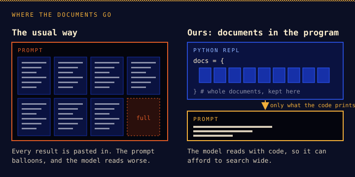

Agentic search is what happens when you give a model a search engine and a hard question, and let it search, read and search again until it finds the answer. [BrowseComp-Plus](https://huggingface.co/spaces/Tevatron/BrowseComp-Plus) is a public benchmark for exactly that. Every entry searches the same fixed set of documents, so you can compare the agents themselves rather than whose web search is better.

I led neuland.ai’s entry. Here’s where it landed:

```stats
2.26% | calibration error, the lowest of all 76 scored entries
8.1 | searches per question, the fewest of any entry above 85% accuracy
87.1% | accuracy, with GPT-5 and the Reason-ModernColBERT retriever
```

## Two things that matter if you want to trust it

Accuracy alone doesn’t tell you whether you can rely on a search agent. Two other numbers do.

- **Calibration error.** When the agent says it’s 90% sure, is it right about 90% of the time? A well-calibrated agent knows when it doesn’t know, which is what you need before you let it answer on its own.
- **Searches per question.** Every search costs time and money. An agent that finds the answer in eight searches instead of thirteen is cheaper, faster and easier to follow.

Here’s every entry on the leaderboard above 85% accuracy, plotted on those two numbers:


Ours sits alone in the bottom-left corner. The only entry with a similar calibration error, AI21’s, coordinates eight agents and makes over 200 searches per question.

## The fairest comparison

Leaderboard entries use different models and retrievers, so most comparisons mix several things at once. LightOn’s entry is the exception: it uses the same model and the same retriever as ours, so the agent is the only thing that differs. It reaches 87.6% with 13.3 searches per question and a calibration error of 6.1%. At the same accuracy, ours needs:

```stats
39% | fewer searches
2.7× | lower calibration error
```

## What the agent does differently



Most search agents paste every result into the prompt. Ours keeps them in a program instead. It runs in a patched recursive-language-model REPL: the agent writes Python, calls search from its code, and decides itself how many documents each search should bring back. The documents stay in a variable, the agent reads them by slicing and grepping with code, and only what it prints ends up in its context.

That changes the economics of searching. A document costs nothing until the agent looks at it, so each search can go wide, and it can be capped at ten searches per question without starving the agent of evidence. It also has tools to check an answer against the evidence it already holds before committing to it.

## Smaller models too

I’ve also trained small language models with supervised fine-tuning and reinforcement learning to get better at agentic search, so this kind of behaviour doesn’t need a frontier model behind it.

The approach started as a paper I wrote in my spare time with colleagues. The [research page](#/research/agentic-search) has the method, the ablations and the full results.
