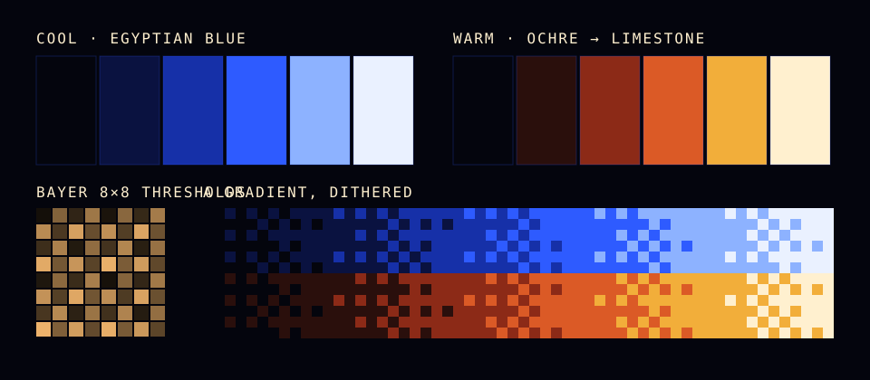

A Nilometer is one of the oldest data instruments in the world: a stepped shaft or a graduated column that measured the height of the Nile flood, and with it the harvest to come. It felt like the right ancestor for a site about agentic search: an instrument built to *measure a flow of information* and turn it into decisions.

I built the site with an agent harness I made myself. The same harness also wrote and ran the browser tests that walk through every chapter, the phone layout, keyboard navigation and reduced motion.

## Four places, one machine

The journey is one continuous world, rendered in real time. Each chapter of the site is a place in that world, and the camera never cuts between them.

| Chapter  | Place               | What happens                                         |
|----------|---------------------|------------------------------------------------------|
| Home     | The Horizon gate    | A pixel sun rises between two pylon towers            |
| About    | The Hall of Columns | The sun fractures; its data assembles into columns    |
| Research | The Nilometer       | The camera descends a stepped shaft as the water rises |
| Writing  | The Delta           | The river branches into a search tree of light        |

The pylon towers and the sun between them echo the hieroglyph for *horizon*. The delta is a search tree: one question, many branches, a few bright results at the leaves.

## A palette from a pigment

Every pixel on screen is drawn from two ramps. The cool ramp is built around **Egyptian blue**: calcium copper silicate, often called the first synthetic pigment. The warm ramp runs from burnt umber through red ochre to gold and limestone.



The scene is rendered at a low resolution, then a post-processing shader maps each pixel's brightness onto a ramp, choosing the warm or cool ramp by the pixel's temperature. Ordered dithering decides between neighbouring steps:

```glsl
float bayer2(vec2 a) { a = floor(a); return fract(a.x / 2.0 + a.y * a.y * 0.75); }
#define bayer4(a) (bayer2(0.5 * (a)) * 0.25 + bayer2(a))
#define bayer8(a) (bayer4(0.5 * (a)) * 0.25 + bayer2(a))

vec3 ramp(vec3 c, float threshold) {
  float x = clamp(luma(c), 0.0, 1.0) * 5.0;
  float i = floor(x) + step(threshold, fract(x));
  return warmth(c) > 0.0 ? WARM[int(i)] : COOL[int(i)];
}
```

The browser then scales the small image up with `image-rendering: pixelated`, so the pixels stay crisp while all text stays sharp, selectable HTML on top.

## Calm when it matters

Motion stops when you start reading: opening an article swaps the world for this quiet layout. People who ask their system for reduced motion get still "plates" of each scene instead of camera movement, and the motion switch in the header does the same for anyone.

```ts
const prefersReduced = matchMedia('(prefers-reduced-motion: reduce)').matches;
const motion = stored ?? !prefersReduced; // the header switch overrides the system setting
```
