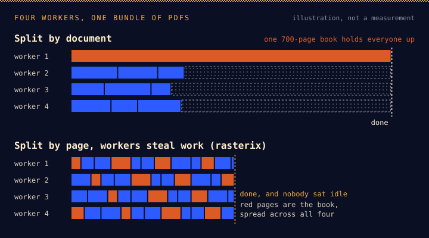
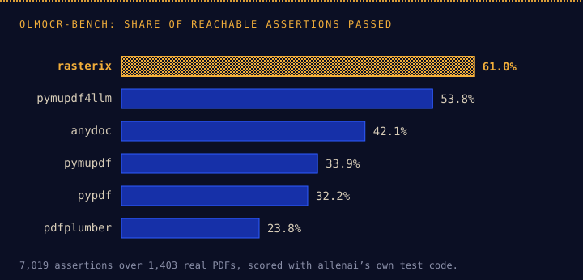

I spent a weekend on a toy project called [rasterix](#/research/rasterix): a Rust-backed Python PDF rasterizer, built for one very specific part of the ingestion stack we’re building at neuland.ai.

In a low-latency ingestion pipeline, rendering pages isn’t some boring preprocessing detail. It sits right on the critical path:

**PDF page → PNG image → OCR or vision-language model worker**

So milliseconds matter. When you render millions or billions of pages, 1 ms per page isn’t cosmetic. It’s throughput, latency and infrastructure cost.

## The problem: one big book holds everyone up

It started with a chat with a colleague about our Ray pipelines, and the idea popped up: what if we had a Rust-native renderer with Python bindings, shaped around the way we actually batch and spread out rendering work?

In Ray, documents are naturally spread across tasks or actors. But if you only split the work by document, one worker gets a 700-page book while the others get short papers and finish early. Everyone ends up waiting for the book:



## The fix: split the work by page

So rasterix has a bundled page-worker mode:

**PDF bundle → page jobs → parallel Rust workers → PNG bytes**

One Python process reserves N CPUs, flattens a whole bundle of PDFs into page-level jobs, and lets Rust workers steal work from each other across the bundle. Nobody sits idle while someone else is stuck on the book.

Under the hood it still does the normal PDF pipeline: parse objects, xrefs and page trees, decode streams, interpret drawing operators, resolve fonts, images and colours, rasterize into a pixel buffer, and return encoded PNG bytes.

## The numbers

On a local benchmark, returning PNG bytes through Python APIs:

```stats
12,000 | pages rendered, at 150 DPI
5.28 ms | per page, from one Python process with internal Rust workers
```

The nuance matters: PyMuPDF is extremely strong in a Python process-pool setup. What I’m really happy about is that rasterix exposes the Ray-shaped batching path directly. That means less Python scheduling glue, fewer long tails, and PNG bytes ready for OCR and vision-model inference inside Ray.

## Where it went next

That weekend project didn’t stay small. rasterix has grown into a full document engine that also turns PDFs and nine office formats into Markdown. On olmOCR-bench it now comes first of the six open-source text extractors I compared:



And against PyMuPDF on the same documents:

```stats
6.7× | faster rendering on 16 cores: 768 pages per second against 115
2× | faster text extraction: 722 pages per second against 368
383 ms | for the slowest page in the corpus, against 1,041 ms
```

It’s still behind pymupdf4llm on tables, and on a typical single page PyMuPDF is a little quicker. The [project page](#/research/rasterix) has the full breakdown.
